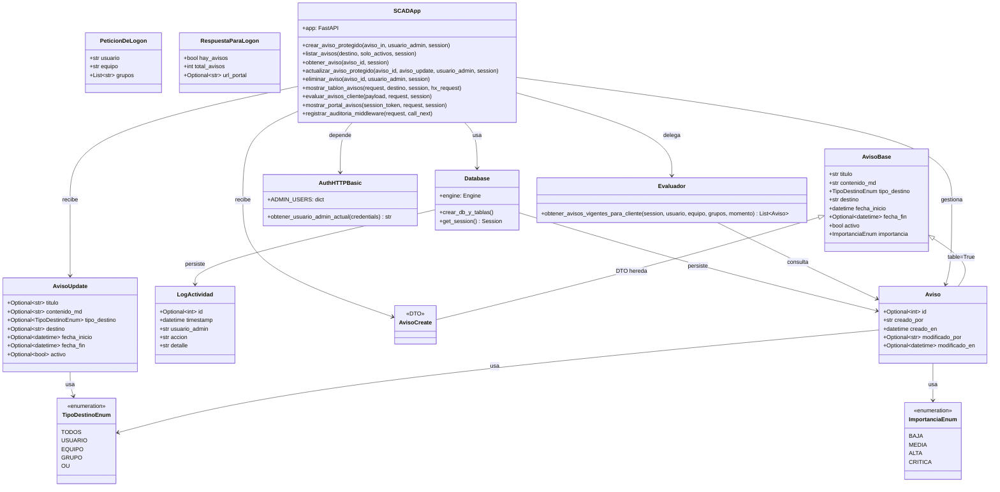
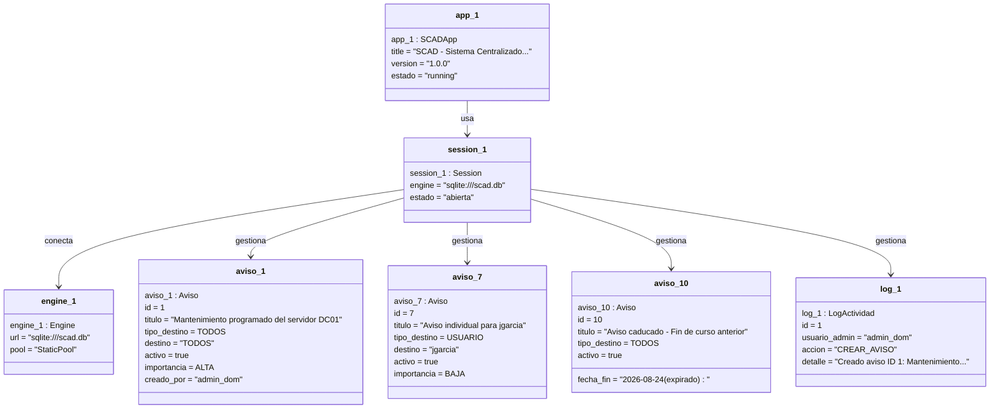
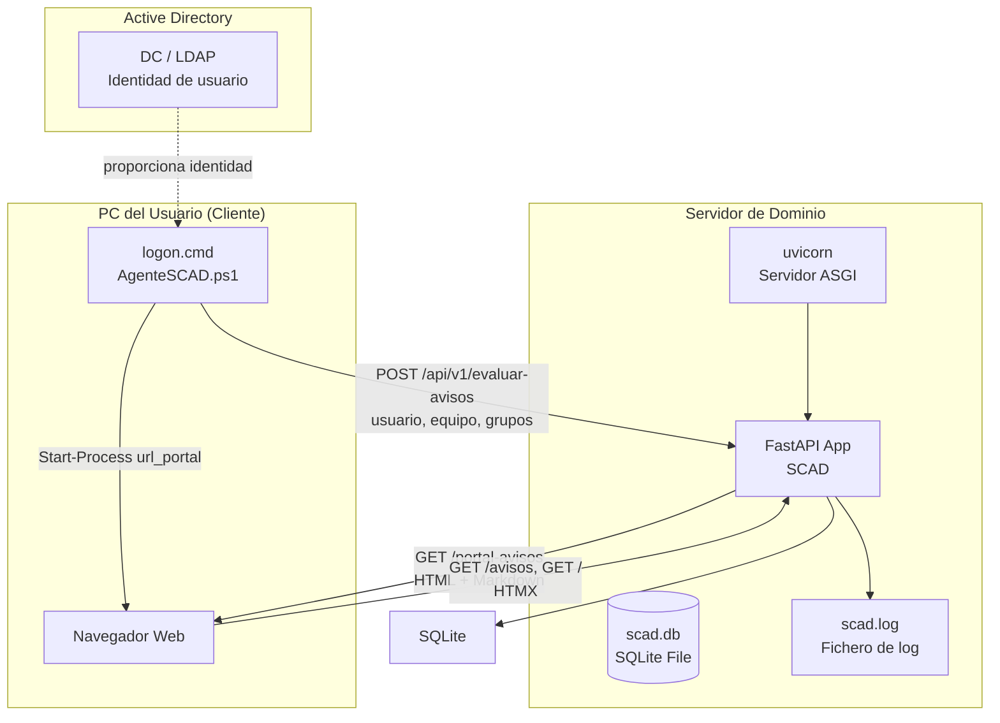
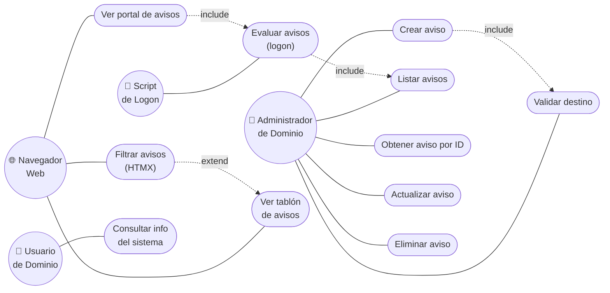
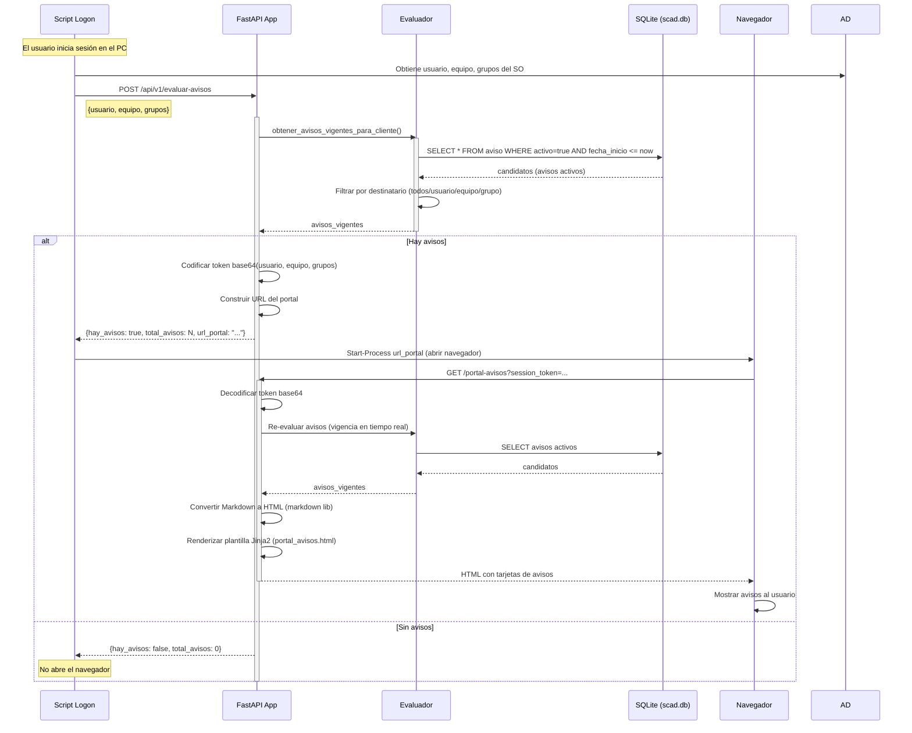
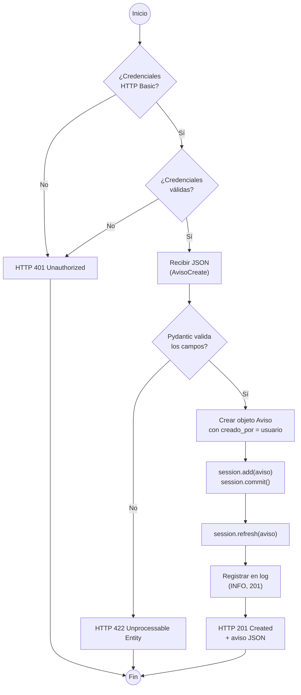
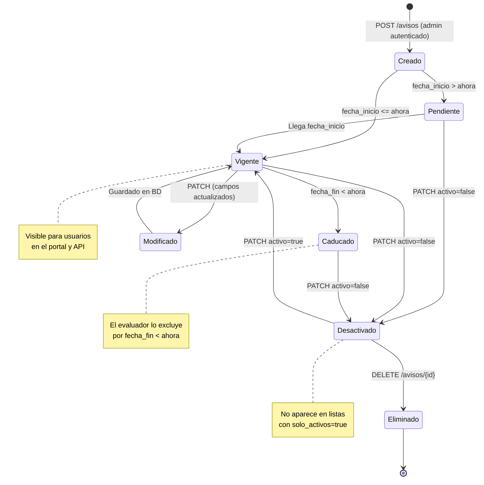

# Documentación del Proyecto SCAD

## Sistema Centralizado de Avisos de Dominio (SCAD)

---

## Tabla de Contenidos

1. [Introducción](#1-introducción)
2. [Requisitos Funcionales](#2-requisitos-funcionales)
3. [Requisitos No Funcionales](#3-requisitos-no-funcionales)
4. [Casos de Uso](#4-casos-de-uso)
5. [Diagramas Estructurales](#5-diagramas-estructurales)
   - 5.1 [Diagrama de Clases](#51-diagrama-de-clases)
   - 5.2 [Diagrama de Objetos](#52-diagrama-de-objetos)
   - 5.3 [Diagrama de Componentes](#53-diagrama-de-componentes)
   - 5.4 [Diagrama de Despliegue](#54-diagrama-de-despliegue)
6. [Diagramas de Comportamiento](#6-diagramas-de-comportamiento)
   - 6.1 [Diagrama de Casos de Uso](#61-diagrama-de-casos-de-uso)
   - 6.2 [Diagrama de Secuencia](#62-diagrama-de-secuencia)
   - 6.3 [Diagrama de Actividades](#63-diagrama-de-actividades)
   - 6.4 [Diagrama de Estados](#64-diagrama-de-estados)
7. [Estructura de Ficheros](#7-estructura-de-ficheros)
8. [Base de Datos SQLite](#8-base-de-datos-sqlite)

---

## 1. Introducción

SCAD (Sistema Centralizado de Avisos de Dominio) es una aplicación web desarrollada con **Python + FastAPI** que permite a los administradores de un dominio de red (Active Directory) crear, gestionar y distribuir avisos a los usuarios y equipos del dominio. Los avisos se muestran automáticamente cuando un usuario inicia sesión en su equipo, a través de un script de logon que consulta la API y abre el portal web en el navegador.

### Arquitectura del sistema

| Capa | Tecnología | Descripción |
|------|-----------|-------------|
| Gestor de proyecto | uv (Astral) | Resolución de dependencias, entorno virtual y ejecución |
| Backend | FastAPI + SQLModel | API REST con ORM y validación de datos |
| Base de datos | SQLite | Base de datos relacional en un único archivo (`scad.db`) |
| Frontend | Jinja2 + HTMX + Markdown | Plantillas HTML con renderizado en servidor sin JavaScript |
| Testing | pytest + httpx/TestClient | Tests unitarios y de integración |
| Seguridad | HTTP Basic Auth | Autenticación de administradores |

### Actores del sistema

| Actor | Descripción |
|-------|-------------|
| **Administrador de dominio** | Crea, edita y elimina avisos mediante la API o la interfaz Swagger. Requiere autenticación HTTP Basic. |
| **Usuario de dominio** | Recibe los avisos al iniciar sesión. El script `logon.cmd` consulta la API en su nombre. |
| **Navegador web** | Renderiza el portal de avisos en HTML cuando el script de logon abre la URL. |
| **Script de logon (AgenteSCAD)** | Script PowerShell que se ejecuta al iniciar sesión, envía la identidad del usuario/equipo a la API y abre el navegador. |

---

## 2. Requisitos Funcionales

### RF-01: Gestión de avisos (CRUD)

El sistema debe permitir a los administradores crear, consultar, modificar y eliminar avisos.

- **RF-01.1**: Crear aviso (`POST /avisos`) con validación de datos (titulo, contenido, tipo de destino, destino, fechas). Requiere autenticación.
- **RF-01.2**: Listar avisos (`GET /avisos`) con filtros por destino y estado activo. Acceso público.
- **RF-01.3**: Obtener un aviso por ID (`GET /avisos/{id}`). Acceso público.
- **RF-01.4**: Actualizar parcialmente un aviso (`PATCH /avisos/{id}`). Requiere autenticación.
- **RF-01.5**: Eliminar un aviso (`DELETE /avisos/{id}`). Requiere autenticación.

### RF-02: Validación de destinos de dominio

El sistema debe validar que los destinatarios de los avisos cumplen las reglas de nomenclatura del dominio.

- **RF-02.1**: Validar tipo de destino (`usuario`, `equipo`, `grupo`, `ou`) mediante enumeración.
- **RF-02.2**: Los nombres de equipo deben empezar por `PC-` o `SRV-`. Si no, devolver error 400.
- **RF-02.3**: El nombre de destino debe tener entre 3 y 50 caracteres.

### RF-03: Autenticación de administradores

El sistema debe proteger las operaciones de administración con autenticación HTTP Basic.

- **RF-03.1**: Las rutas `POST`, `PATCH` y `DELETE` de avisos requieren credenciales válidas.
- **RF-03.2**: Las rutas `GET` de avisos son de acceso público (sin autenticación).
- **RF-03.3**: Si las credenciales son incorrectas, devolver HTTP 401 con cabecera `WWW-Authenticate: Basic`.
- **RF-03.4**: El usuario autenticado se registra automáticamente en los campos `creado_por` y `modificado_por`.

### RF-04: Evaluación de avisos para logon

El sistema debe evaluar qué avisos corresponden a un usuario/equipo cuando inicia sesión.

- **RF-04.1**: Endpoint `POST /api/v1/evaluar-avisos` recibe usuario, equipo y grupos del cliente.
- **RF-04.2**: Filtrar avisos por vigencia temporal (activo, fecha_inicio, fecha_fin).
- **RF-04.3**: Filtrar avisos por destinatario según reglas del dominio (todos, usuario, equipo, grupo).
- **RF-04.4**: Devolver URL del portal web con token de sesión codificado en base64.

### RF-05: Portal web de avisos

El sistema debe renderizar los avisos en una página HTML accesible por navegador.

- **RF-05.1**: Endpoint `GET /portal-avisos?session_token=...` decodifica el token y re-evalúa los avisos.
- **RF-05.2**: El contenido Markdown se convierte a HTML en el servidor.
- **RF-05.3**: La plantilla muestra tarjetas con título, importancia, fecha y contenido renderizado.

### RF-06: Frontend con HTMX y Jinja2

El sistema debe proporcionar un tablón de avisos interactivo sin escribir JavaScript.

- **RF-06.1**: Ruta `GET /` renderiza el tablón completo con Jinja2.
- **RF-06.2**: Si la petición incluye cabecera `HX-Request`, devolver solo el fragmento parcial.
- **RF-06.3**: El filtro por destino se realiza mediante HTMX sin recargar la página.

### RF-07: Auditoría y logging

El sistema debe registrar todas las peticiones HTTP en un fichero de log.

- **RF-07.1**: Middleware intercepta todas las peticiones y registra IP, método, URL, estado y tiempo.
- **RF-07.2**: Nivel de log: INFO (2xx/3xx), WARNING (4xx), ERROR (5xx).
- **RF-07.3**: Inyectar cabecera `X-Process-Time-MS` en las respuestas.
- **RF-07.4**: Tabla `LogActividad` registra acciones de administradores.

### RF-08: Rutas informativas

El sistema debe proporcionar endpoints informativos básicos.

- **RF-08.1**: `GET /version` devuelve versión, app y organización.
- **RF-08.2**: `GET /equipo-desarrollo` devuelve lista de miembros del equipo.
- **RF-08.3**: `GET /info-dominio` devuelve información del dominio de red.

---

## 3. Requisitos No Funcionales

### Rendimiento

| ID | Requisito | Descripción |
|----|-----------|-------------|
| RNF-01 | Tiempo de respuesta | Las peticiones GET deben responder en menos de 100ms en local. |
| RNF-02 | Escalabilidad | SQLite soporta cientos de avisos sin degradación apreciable. |
| RNF-03 | Procesamiento asíncrono | El middleware usa `async/await` para no bloquear el event loop. |

### Seguridad

| ID | Requisito | Descripción |
|----|-----------|-------------|
| RNF-04 | Autenticación robusta | Uso de `secrets.compare_digest` para evitar timing attacks. |
| RNF-05 | Validación de entrada | Pydantic valida y sanitiza todos los datos de entrada (HTTP 422). |
| RNF-06 | Escape de HTML | Jinja2 escapa HTML por defecto; `| safe` solo en contenido Markdown procesado. |
| RNF-07 | Token de sesión | El portal web usa tokens base64 para evitar manipulación de parámetros. |

### Mantenibilidad

| ID | Requisito | Descripción |
|----|-----------|-------------|
| RNF-08 | Separación de capas | Modelos, autenticación, lógica de negocio y logging en módulos independientes. |
| RNF-09 | Cobertura de tests | Suite de 34 tests que cubre rutas, CRUD, seguridad, logging y E2E. |
| RNF-10 | Documentación automática | FastAPI genera Swagger UI (`/docs`) y ReDoc (`/redoc`). |

### Portabilidad

| ID | Requisito | Descripción |
|----|-----------|-------------|
| RNF-11 | Sin servicios externos | SQLite no requiere instalar un servidor de base de datos. |
| RNF-12 | Multiplataforma | Python 3.12+ en Windows, Linux o macOS. |
| RNF-13 | Aislamiento de dependencias | uv gestiona el entorno virtual sin interferir con el sistema. |

### Usabilidad

| ID | Requisito | Descripción |
|----|-----------|-------------|
| RNF-14 | Interfaz sin JavaScript | HTMX permite interactividad desde HTML puro. |
| RNF-15 | Documentación interactiva | Swagger UI permite probar todos los endpoints desde el navegador. |

---

## 4. Casos de Uso

### CU-01: Crear aviso

| Campo | Descripción |
|-------|-------------|
| **Actor** | Administrador de dominio |
| **Precondición** | Autenticación HTTP Basic válida |
| **Flujo principal** | 1. El admin envía POST /avisos con datos del aviso. 2. Pydantic valida los campos. 3. Se persiste en SQLite. 4. Se devuelve el aviso creado con HTTP 201. |
| **Flujo alternativo** | Si no hay credenciales → 401. Si los datos son inválidos → 422. |
| **Postcondición** | El aviso queda almacenado y visible para los destinatarios. |

### CU-02: Consultar avisos

| Campo | Descripción |
|-------|-------------|
| **Actor** | Usuario de dominio / Administrador |
| **Precondición** | Ninguna (acceso público) |
| **Flujo principal** | 1. Se envía GET /avisos con filtros opcionales (destino, solo_activos). 2. Se consultan los avisos en SQLite. 3. Se devuelve la lista en JSON. |
| **Postcondición** | El cliente recibe la lista de avisos aplicables. |

### CU-03: Filtrar avisos dinámicamente (HTMX)

| Campo | Descripción |
|-------|-------------|
| **Actor** | Navegador web |
| **Precondición** | Página del tablón cargada |
| **Flujo principal** | 1. El usuario selecciona un destino en el desplegable. 2. HTMX envía GET / con cabecera HX-Request. 3. El servidor devuelve solo el fragmento HTML. 4. HTMX reemplaza el contenedor sin recargar la página. |
| **Postcondición** | La lista se actualiza con los avisos filtrados. |

### CU-04: Evaluar avisos al iniciar sesión (logon)

| Campo | Descripción |
|-------|-------------|
| **Actor** | Script de logon (AgenteSCAD) |
| **Precondición** | El usuario ha iniciado sesión en el equipo del dominio |
| **Flujo principal** | 1. El script envía POST /api/v1/evaluar-avisos con usuario, equipo y grupos. 2. El evaluador filtra por vigencia y destinatario. 3. Si hay avisos, se devuelve URL del portal con token. 4. El script abre el navegador con la URL. |
| **Flujo alternativo** | Si no hay avisos → `hay_avisos: false`. |
| **Postcondición** | El navegador muestra el portal de avisos. |

### CU-05: Ver portal de avisos

| Campo | Descripción |
|-------|-------------|
| **Actor** | Navegador web |
| **Precondición** | URL del portal con token de sesión válido |
| **Flujo principal** | 1. El navegador abre GET /portal-avisos?session_token=... 2. Se decodifica el token base64. 3. Se re-evalúan los avisos. 4. Se renderiza el HTML con Markdown convertido. |
| **Flujo alternativo** | Si el token es inválido → HTTP 400 "Sesión inválida". |
| **Postcondición** | El usuario ve sus avisos en formato HTML. |

### CU-06: Actualizar aviso

| Campo | Descripción |
|-------|-------------|
| **Actor** | Administrador de dominio |
| **Precondición** | Autenticación HTTP Basic válida |
| **Flujo principal** | 1. El admin envía PATCH /avisos/{id} con campos a modificar. 2. Se actualizan solo los campos enviados. 3. Se registra `modificado_por` y `modificado_en`. 4. Se devuelve el aviso actualizado. |
| **Flujo alternativo** | Si el aviso no existe → 404. |
| **Postcondición** | El aviso queda actualizado en la BD. |

### CU-07: Eliminar aviso

| Campo | Descripción |
|-------|-------------|
| **Actor** | Administrador de dominio |
| **Precondición** | Autenticación HTTP Basic válida |
| **Flujo principal** | 1. El admin envía DELETE /avisos/{id}. 2. Se elimina el aviso de la BD. 3. Se devuelve HTTP 204. |
| **Flujo alternativo** | Si el aviso no existe → 404. |
| **Postcondición** | El aviso queda eliminado permanentemente. |

### CU-08: Validar destino de dominio

| Campo | Descripción |
|-------|-------------|
| **Actor** | Administrador de dominio |
| **Precondición** | Ninguna |
| **Flujo principal** | 1. El admin envía POST /validar-destino con tipo y nombre. 2. Se valida el tipo contra la enumeración. 3. Si es equipo, se valida el prefijo (PC-/SRV-). 4. Se devuelve `{"valido": true, "destino": "TIPO:NOMBRE"}`. |
| **Flujo alternativo** | Tipo no permitido → 422. Equipo sin prefijo correcto → 400. |

---

## 5. Diagramas Estructurales

### 5.1 Diagrama de Clases

Representa las clases principales del sistema, sus atributos, métodos y relaciones.



### 5.2 Diagrama de Objetos

Muestra una instancia concreta del sistema en un momento de ejecución, con objetos reales y sus enlaces.



### 5.3 Diagrama de Componentes

Modela la organización física y las dependencias de los módulos de software.

```mermaid
graph TB
    subgraph "Profesor - src"
        MAIN["main.py<br/>FastAPI App + Rutas"]
        MODELS["models.py<br/>SQLModel + Engine"]
        AUTH["auth.py<br/>HTTP Basic Auth"]
        LOG["logger.py<br/>Logging Config"]
        EVAL["evaluador.py<br/>Lógica de Negocio"]
        SCHEMAS["schemas.py<br/>DTOs Logon"]
    end

    subgraph "Frontend"
        TEMPLATES["templates/<br/>Jinja2 + HTMX"]
        STATIC["static/<br/>CSS"]
    end

    subgraph "Persistencia"
        DB[("scad.db<br/>SQLite")]
    end

    subgraph "Testing"
        CONF["conftest.py<br/>Fixtures"]
        TESTS["test_*.py<br/>pytest + TestClient"]
    end

    MAIN --> MODELS : importa modelos
    MAIN --> AUTH : depende auth
    MAIN --> LOG : usa logger
    MAIN --> EVAL : delega evaluación
    MAIN --> SCHEMAS : usa DTOs
    MAIN --> TEMPLATES : renderiza
    MAIN --> STATIC : sirve CSS
    MODELS --> DB : create_all + Session
    EVAL --> MODELS : consulta Aviso
    AUTH --> MODELS : (sin dependencia directa)
    TESTS --> CONF : usa fixtures
    CONF --> MAIN : importa app
    CONF --> MODELS : override get_session
```

### 5.4 Diagrama de Despliegue

Representa la arquitectura física del hardware y dónde se ejecutan los componentes.



---

## 6. Diagramas de Comportamiento

### 6.1 Diagrama de Casos de Uso

Muestra las funcionalidades del sistema desde la perspectiva de los actores.



### 6.2 Diagrama de Secuencia

Detalla la interacción entre objetos durante el flujo completo de logon a portal web.



### 6.3 Diagrama de Actividades

Muestra el flujo de control para la creación de un aviso con autenticación y validación.



### 6.4 Diagrama de Estados

Representa el ciclo de vida de un objeto Aviso desde su creación hasta su eliminación.



---

## 7. Estructura de Ficheros

```
Curso/scad/
├── pyproject.toml                     Configuración del proyecto (uv): dependencias y pytest
├── .python-version                    Versión de Python (3.12)
├── uv.lock                            Lock de dependencias resueltas por uv
├── README.md                          Documentación rápida de arranque
├── seed_db.py                         Script de poblado de la BD con datos de ejemplo
├── scad.db                            Base de datos SQLite (generada al arrancar, no commiteada)
│
├── docs/
│   └── documentacion.md              Este documento
│
├── profesor/                          Implementación de referencia (demostraciones del curso)
│   ├── src/
│   │   ├── __init__.py                Marca el directorio como paquete Python
│   │   ├── main.py                   Aplicación FastAPI completa:
│   │   │                                - Lifespan (crear tablas)
│   │   │                                - Middleware de auditoría + cabecera X-Process-Time-MS
│   │   │                                - CRUD de avisos (con auth)
│   │   │                                - Tablón HTML con Jinja2 + HTMX
│   │   │                                - Endpoint de logon (POST /api/v1/evaluar-avisos)
│   │   │                                - Portal web (GET /portal-avisos)
│   │   │                                - Filtro Markdown → HTML
│   │   ├── models.py                 Modelos SQLModel:
│   │   │                                - TipoDestinoEnum, ImportanciaEnum
│   │   │                                - AvisoBase, Aviso (table=True), LogActividad (table=True)
│   │   │                                - AvisoCreate, AvisoUpdate (DTOs)
│   │   │                                - Engine SQLite + get_session()
│   │   ├── auth.py                   Autenticación HTTP Basic:
│   │   │                                - ADMIN_USERS (simulados)
│   │   │                                - obtener_usuario_admin_actual()
│   │   ├── logger.py                  Configuración de logging:
│   │   │                                - FileHandler → scad.log
│   │   │                                - StreamHandler → consola
│   │   ├── evaluador.py              Lógica de negocio:
│   │   │                                - Filtro de vigencia temporal
│   │   │                                - Algoritmo de destinatario (todos/usuario/equipo/grupo)
│   │   ├── schemas.py                Esquemas Pydantic del logon:
│   │   │                                - PeticionDeLogon, RespuestaParaLogon
│   │   ├── static/
│   │   │   └── css/
│   │   │       ├── styles.css         Estilos del tablón de avisos
│   │   │       └── scad.css           Estilos del portal web
│   │   ├── templates/
│   │   │   ├── base.html              Plantilla base con HTMX CDN
│   │   │   ├── avisos.html            Tablón con filtro HTMX
│   │   │   ├── _lista_avisos.html     Fragmento parcial para HTMX
│   │   │   └── portal_avisos.html     Portal de avisos para el navegador
│   │   └── logs/                      Directorio de logs (generado, no commiteado)
│   │       └── scad.log
│   └── tests/
│       ├── conftest.py                Fixtures: engine en memoria, session, client
│       ├── test_htmx.py              Tests de fragmentos parciales HTMX
│       ├── test_evaluador.py          Tests del algoritmo de evaluación
│       └── test_e2e_logon.py         Tests end-to-end del flujo logon → portal
│
└── alumno/                            Ejercicios resueltos del curso
    ├── src/
    │   ├── __init__.py
    │   ├── main.py                   App FastAPI con todos los ejercicios integrados:
    │   │                                - Rutas básicas (/, /version, /equipo-desarrollo, /info-dominio)
    │   │                                - /validar-destino con validación de negocio
    │   │                                - CRUD de avisos con auth
    │   │                                - Middleware de logging
    │   │                                - Jinja2 + HTMX + Markdown
    │   ├── models.py                 Modelos SQLModel (mismo esquema que profesor)
    │   ├── logger.py                  Configuración de logging
    │   ├── static/css/styles.css
    │   ├── templates/
    │   │   ├── base.html
    │   │   ├── avisos.html
    │   │   └── _lista_avisos.html
    │   └── logs/
    │       └── scad.log
    └── tests/
        ├── conftest.py                Fixtures con SQLite en memoria
        ├── test_main.py              Tests de rutas básicas y renderizado Markdown
        ├── test_validaciones.py       Tests de /validar-destino
        ├── test_models.py             Tests de modelos SQLModel
        ├── test_crud_avisos.py        Tests del CRUD completo
        ├── test_seguridad.py          Tests de autenticación HTTP Basic
        └── test_logging.py           Tests de middleware y cabeceras
```

---

## 8. Base de Datos SQLite

### 8.1 Descripción general

SCAD utiliza **SQLite**, una base de datos relacional completa contenida en un único archivo plano (`scad.db`). No requiere instalar servicios externos ni servidores separados, lo que la hace ideal para desarrollo y entornos locales.

- **Ubicación del archivo**: `Curso/scad/scad.db` (se genera automáticamente al arrancar la aplicación)
- **Driver**: `sqlmodel` (combina Pydantic + SQLAlchemy)
- **URL de conexión**: `sqlite:///scad.db`
- **Modo**: `echo=False` (sin logs de SQL en consola)

### 8.2 Esquema de tablas

#### Tabla `aviso`

Almacena los avisos del sistema.

| Columna | Tipo | Constraints | Descripción |
|---------|------|------------|-------------|
| `id` | INTEGER | PRIMARY KEY, AUTOINCREMENT | Identificador único |
| `titulo` | VARCHAR | min_length=3, max_length=100, INDEX | Título del aviso |
| `contenido_md` | TEXT | NOT NULL | Contenido en formato Markdown |
| `tipo_destino` | VARCHAR | ENUM (todos, usuario, equipo, grupo, ou) | Tipo de destinatario |
| `destino` | VARCHAR | INDEX | Nombre del destinatario |
| `fecha_inicio` | DATETIME | NOT NULL | Fecha de entrada en vigor |
| `fecha_fin` | DATETIME | NULLABLE | Fecha de caducidad |
| `activo` | BOOLEAN | DEFAULT TRUE | Estado activo/inactivo |
| `importancia` | VARCHAR | ENUM (baja, media, alta, critica), DEFAULT 'media' | Nivel de importancia |
| `creado_por` | VARCHAR | NOT NULL | Usuario admin que lo creó |
| `creado_en` | DATETIME | DEFAULT now() | Timestamp de creación |
| `modificado_por` | VARCHAR | NULLABLE | Usuario admin que lo modificó |
| `modificado_en` | DATETIME | NULLABLE | Timestamp de modificación |

#### Tabla `logactividad`

Registro de auditoría de acciones administrativas.

| Columna | Tipo | Constraints | Descripción |
|---------|------|------------|-------------|
| `id` | INTEGER | PRIMARY KEY, AUTOINCREMENT | Identificador único |
| `timestamp` | DATETIME | DEFAULT now() | Momento de la acción |
| `usuario_admin` | VARCHAR | NOT NULL | Administrador que ejecutó la acción |
| `accion` | VARCHAR | NOT NULL | Tipo de acción (CREAR_AVISO, DESACTIVAR_AVISO, etc.) |
| `detalle` | VARCHAR | NOT NULL | Descripción detallada de la acción |

### 8.3 Creación automática

Las tablas se crean automáticamente al arrancar la aplicación mediante el lifespan de FastAPI:

```python
@asynccontextmanager
async def lifespan(app: FastAPI):
    crear_db_y_tablas()  # SQLModel.metadata.create_all(engine)
    yield
```

Esto ejecuta `SQLModel.metadata.create_all(engine)`, que analiza todas las clases con `table=True` y crea las tablas en `scad.db` si no existen.

### 8.4 Poblado de datos

El proyecto incluye el script **`seed_db.py`** en la raíz, que inserta datos de ejemplo en ambas tablas.

#### Ejecución

```powershell
# Desde el directorio Curso/scad/
uv run python seed_db.py
```

#### Datos insertados

**12 avisos** que cubren todos los tipos de destino:

| # | Título | tipo_destino | destino | importancia |
|---|--------|-------------|---------|------------|
| 1 | Mantenimiento programado del servidor DC01 | todos | TODOS | alta |
| 2 | Cambio de contraseña obligatorio | todos | TODOS | critica |
| 3 | Actualización de antivirus en equipos del aula 101 | equipo | PC-AULA101-01 | media |
| 4 | Corte de WiFi por mantenimiento de red | grupo | Alumnos | alta |
| 5 | Reunión de claustro para profesores | grupo | Docentes | media |
| 6 | Nuevo software disponible: Python 3.12 | grupo | Alumnos | baja |
| 7 | Aviso individual para jgarcia | usuario | jgarcia | baja |
| 8 | Mantenimiento del equipo SRV-DC02 | equipo | SRV-DC02 | alta |
| 9 | Inventario de hardware pendiente | ou | OU-AULAS | media |
| 10 | Aviso caducado - Fin de curso anterior | todos | TODOS | media |
| 11 | Backup de perfiles en OU-ADMIN | ou | OU-ADMIN | baja |
| 12 | Mensaje personal para mlopez | usuario | mlopez | media |

**12 registros de auditoría** con acciones de los administradores `admin_dom` y `soporte_dom`:
- `CREAR_AVISO` (7 registros)
- `DESACTIVAR_AVISO` (1 registro)
- `MODIFICAR_AVISO` (1 registro)
- `ELIMINAR_AVISO` (1 registro)
- `INICIO_SESION` (2 registros)

#### Cómo funciona el script

1. Llama a `crear_db_y_tablas()` para asegurar que las tablas existen.
2. Abre una sesión con el engine de SQLite.
3. Crea objetos `Aviso` con datos realistas (fechas relativas al momento actual, contenido Markdown).
4. Crea objetos `LogActividad` con acciones coherentes con los avisos insertados.
5. Inserta todo con `session.add_all()` y confirma con `session.commit()`.

### 8.5 Consulta de datos

Desde la API:

```powershell
# Listar todos los avisos activos
curl http://127.0.0.1:8000/avisos

# Filtrar por destino
curl "http://127.0.0.1:8000/avisos?destino=Alumnos"

# Obtener un aviso por ID
curl http://127.0.0.1:8000/avisos/1
```

Desde Python:

```python
from sqlmodel import Session, select
from profesor.src.models import Aviso, engine

with Session(engine) as session:
    avisos = session.exec(select(Aviso).where(Aviso.activo == True)).all()
    for a in avisos:
        print(f"[{a.id}] {a.titulo} → {a.tipo_destino}:{a.destino}")
```

Desde la extensión **SQLite Viewer** de VS Code: abrir el archivo `scad.db` para inspeccionar visualmente las tablas y los datos.

### 8.6 Tests con base de datos en memoria

Los tests no tocan el archivo `scad.db`. En su lugar, usan una base de datos SQLite efímera en memoria:

```python
# conftest.py
engine = create_engine(
    "sqlite://",
    connect_args={"check_same_thread": False},
    poolclass=StaticPool
)
SQLModel.metadata.create_all(engine)
```

Y sobrescriben la dependencia `get_session` para que la app use esta BD temporal:

```python
app.dependency_overrides[get_session] = lambda: session
```

Esto garantiza que cada ejecución de tests parte de un estado limpio, sin datos residuales.
